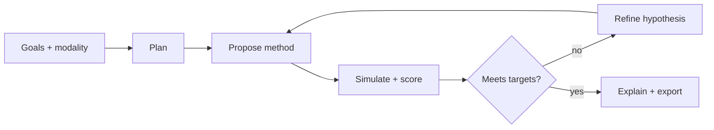

# Chumba Labs — Meta Hackathon MVP Scope (Oct 27 – Nov 4, 2026)

**Repo state:** `context/` only (this doc + `event_details.md`). Greenfield build; public OSS repo required.

---

## One-line pitch

**Autonomous agent for separation-method development: user picks HPLC or GC-MS, sets goals, and the agent proposes, scores, and refines instrument methods in a verifiable loop—compressing decision cycles, not replacing the lab.**

---

## Product boundary (long-term B2B)

| In scope | **HPLC** and **GC-MS** method development only (mobile phase / gradient / column / flow / temperature—or GC oven program, carrier flow, inlet, MS acquisition sketch). |
| Out of scope (for now) | NMR, IC, chiral, 2D-LC, prep scale, general “analytical AI” platform. |

Same **agent shell** for both modalities; **modality-specific tool plugins** (simulate, score, catalogs). No need to broaden beyond LC + GC for hackathon or near-term SKU.

---

## Problem statement track

| Primary | **Build for Your World** — analytical method development is domain pain you know; Meta models orchestrate decisions analysts already make, with auditable rationale. |
| Secondary angle | **Push the Frontier** — give a machine a *verifiable* capability: constrained optimization over chromatography state (retention, resolution, run time) with tool-grounded outputs, not free-form chat. |

Judges care that this is **not** a generic chatbot over PDFs (explicit anti-pattern: “Basic RAG Applications”). Retrieval, if any, is **narrow** (e.g., internal SOP snippets or parameter bounds), not the product.

---

## Problem statement (for submission copy)

Analytical labs spend disproportionate time on **method development**: choosing column chemistry, gradient or oven program, flow, and detection settings to hit resolution and cycle-time targets. Expertise is scarce; runs are expensive; decisions are rarely captured in a reusable way. Chumba is an **agentic copilot** that maintains structured **method state** per modality (HPLC or GC-MS), calls **deterministic scoring/simulation tools**, and uses **Muse Spark** for planning, hypothesis generation, and human-readable justification—so the analyst approves the next experiment, not the model alone.

---

## Credits & infrastructure split

| Resource | Primary use in Chumba | Notes |
|----------|----------------------|--------|
| **Meta Model API credits ($150)** | **Muse Spark** — agent orchestration, tool calling, structured method JSON, explanations grounded on tool output | This is where “AI is in action” for reasoning; not for inventing Rs or retention times. |
| **Modal credits ($100)** | **Hosted API/UI**, **chemistry engine** (`simulate_*`, `score_*`, parameter sweeps on **CPU**), secrets for Meta API key server-side | Default mental model: Modal = run the lab math + demo URL—not “Modal exists to serve open weights.” |
| **Modal (optional stretch)** | **Muse Spark Open (`muse-spark-open-1026`)** on GPU | Only if chasing **Best Build on Open Weight Models**; not required for a strong submission. |

**Summary:** Meta = brain; Modal = body (simulation, scoring, deployment). Open-weight inference on Modal is a bonus path, not the core architecture.

---

## MVP scope: IN / OUT (9 days, solo)

### Hackathon strategy: **HPLC carries the demo; GC-MS as thin plugin**

| Layer | Hackathon (Nov 4) | Long-term |
|-------|-------------------|-----------|
| **UX** | User can select **HPLC \| GC-MS** (modality in API/schema) | Same |
| **HPLC** | Full loop: goals → propose → simulate → score → refine (2–3 iterations on video) | Production depth |
| **GC-MS** | **Thin plugin**: oven program + flow + column/type + generic MS method table; simple rules-based score (e.g., run time, resolution proxy)—**no** library search, deconvolution, or tune optimization | Deeper MS ID later |
| **Demo video** | **100% HPLC** if GC-MS is unstable; optional 10–15 s cut showing GC-MS branch or architecture slide | Both modalities live |

| Factor | HPLC (demo lead) | GC-MS (plugin) |
|--------|------------------|----------------|
| Demo data | Synthetic chromatograms + optional one public trace (rights cleared); **SMILES/public structures** for analyte mix | Template methods + synthetic peak layout; avoid spectral library dependency |
| Method knobs | Gradient %B, flow, T, column class | Oven program, carrier flow, inlet mode, scan/SIM sketch |
| Scoring | Rs, retention window, run time (USP-style) | Run time, peak spacing proxy, constraint penalties |
| Risk if both “full” | — | ~2× physics + test surface; keep GC-MS intentionally shallow |

**Rationale:** Product story is **two modalities, one agent**; hackathon execution is **one killer demo (HPLC)** plus proof the architecture extends to GC-MS.

### IN (must ship for credible demo)

- **Modality-aware workflow:** schema supports `hplc` | `gc_ms`; **recorded demo** on reversed-phase **HPLC** gradient for a defined mix (2–5 peaks).
- **Inputs:** public **SMILES** / structure list for the mix (plus goals form); simulation ground truth stays in **your code**, not scraped proprietary methods.
- **Agent loop:** plan → propose method parameters → **score** (tool) → refine (≤3 visible iterations in demo).
- **Tool calling via Muse Spark API:** HPLC tools at minimum (`propose_gradient`, `simulate_chromatogram`, `score_method`, `log_experiment`, `explain_tradeoff`); GC-MS stubs or thin twins (`propose_gc_method`, `simulate_gc_run`, `score_gc_method`) when time allows.
- **Deterministic core:** retention/resolution scoring (rules + simple models), not LLM-invented numbers.
- **Testing order:** **CLI/API + unit tests first**; then **minimal UI** for the 3-minute video (method table, scores, tool trace). **Vue (or richer frontend)** is a **post-hackathon / B2B** stage—not a blocker for proving the loop.
- **Audit trail:** JSON log of agent steps + tool I/O (verifiable agent + B2B compliance seed).
- **Public repo** + **3-minute demo video** with on-screen labels for hackathon-built work.
- **Deploy:** agent API (+ thin UI if used) on **Modal**; Spark calls to **Meta API** from Modal (or local dev).

### OUT (explicitly defer)

- Real instrument control (Agilent/Waters drivers), LIMS/ELN integrations, 21 CFR Part 11 validation.
- Full physics CFD or commercial simulator licenses; **no claim** that simulation replaces empirical confirmation.
- **NMR**, IC, chiral, 2D-LC, prep scale, and other techniques beyond **HPLC + GC-MS**.
- GC-MS: spectral library ID, deconvolution, autotune optimization, proprietary library RAG.
- Training custom deep learning on proprietary customer data.
- “Upload any PDF → magic method” RAG-as-product.
- Medical/clinical diagnostic claims.

### Stretch (only if core HPLC loop is done by Nov 2)

- Export method as **instrument-ready method table** (CSV/text), vendor-neutral.
- GC-MS path stable enough for a short demo clip or live toggle.
- Side-by-side: Spark API vs Spark Open on Modal (bonus prize only).
- Muse Code used in dev only (README mention, not demo centerpiece).

---

## Agent architecture

### Roles

1. **Orchestrator (Muse Spark, tool-calling)** — parses goals and **modality**, selects tools, synthesizes explanations. Does **not** fabricate chromatographic metrics. Implementation: LangChain `create_agent` (LangGraph runtime) and `ChatOpenAI` against Meta's base URL `https://api.meta.ai/v1`, model `muse-spark-1.3`. Without `MODEL_API_KEY`, the same chromatography tools run in a deterministic local loop.
2. **Method proposer (LLM + schema)** — emits JSON method specs within bounds enforced by Pydantic/tools.
3. **Simulator/scorer (code on Modal/local, no LLM)** — modality-specific plugins produce traces and numeric scores.
4. **Critic (optional LLM)** — compares iterations in natural language; must cite tool outputs only.
5. **Memory** — session state + iteration history (SQLite or JSON); not vector DB as hero feature.

### Tools (by modality)

**Shared**

| Tool | Type | Purpose |
|------|------|---------|
| `parse_goals` | LLM or form | Targets, max run time, modality |
| `parse_analytes` | Code + SMILES | Validate structures, rough polarity/volatility hints |
| `write_run_log` | Code | Append-only audit entry |

**HPLC (demo-critical)**

| Tool | Type | Purpose |
|------|------|---------|
| `get_column_catalog` | Static JSON | RP columns, pressure limits |
| `propose_gradient` | LLM structured output | Time / %B segments within guardrails |
| `simulate_chromatogram` | Heuristic | 1D Gaussians; retention from linear solvent strength approx. |
| `score_method` | Rules | Rs, tailing proxy, total time, penalties |
| `suggest_next_experiment` | LLM + last scores | One concrete change grounded in scores |

**GC-MS (thin plugin)**

| Tool | Type | Purpose |
|------|------|---------|
| `get_gc_column_catalog` | Static JSON | Phases, film thickness, max T |
| `propose_gc_method` | LLM structured output | Oven program, flow, inlet, MS mode sketch |
| `simulate_gc_run` | Heuristic | Elution order / peak spacing proxy (not full MS spectra) |
| `score_gc_method` | Rules | Time, spacing, constraint violations |

### Loop (default)



**Max iterations:** 5 automatic; demo shows 2–3 with clear score improvement.

### Rules / heuristics vs LLM vs retrieval

| Component | Implementation |
|-----------|----------------|
| Peak retention vs %B (HPLC) | **Heuristic**: RDKit MolLogP, TPSA, MW, HBD/HBA, and aromatic rings with an LSS-style `log k(φ) = log k_w − Sφ` (approximate, not a validated model) |
| GC elution / spacing proxy | **Heuristic** (offline RDKit boiling-point proxy from MW and H-bonding; not an experimental boiling point) |
| Resolution, run time, constraints | **Rules** with explicit weights |
| Method shape creativity | **LLM** within tool schema |
| Planning & user-facing rationale | **LLM** grounded on tool JSON |
| Column choice | **Catalog lookup** + LLM ranking |
| Optional retrieval | **Light:** lab bounds markdown only—not for scoring |

### Verifiability (Agents 102 alignment)

- Every numeric claim in the UI links to `score_*` output.
- System prompt: refuse to state Rs/tR without tool call.
- Demo moment: ungrounded model answer blocked vs agent path.

### Frontend phasing

| Phase | When | What |
|-------|------|------|
| 1 | Oct 27–29 | CLI + FastAPI; golden tests on simulate/score |
| 2 | Oct 30–Nov 3 | **Minimal** analyst UI (Streamlit, or thin Vue page) for video: goals, modality, method table, scores, tool trace |
| 3 | Post-hackathon | **Vue** (or full SPA) for B2B pilots; pairs with user testing |

UI and end-to-end testing converge in phase 2; chemistry correctness should not wait on frontend.

---

## Meta model usage map

| Use case | Model | Where | Notes |
|----------|--------|--------|--------|
| Agent orchestration + tool calling | **Muse Spark** (Model API) | Meta hosted | Spend **Meta** credits here |
| Structured method JSON | Muse Spark | API | Tool schemas / structured output |
| Explanation & tradeoff narrative | Muse Spark | API | Must reference logged tool results |
| Dev acceleration | **Muse Code** | IDE only | Scaffold, tests, Modal deploy—not a judging feature |
| Open-weight (optional bonus) | **Muse Spark Open `muse-spark-open-1026`** | Modal GPU | Same tool contract; only if time |

**Creative Meta angle (stretch):** chromatogram **screenshot** to Spark vision for peak-picking *assist*; scores still from code.

---

## Modal usage (what runs where)

| Workload | Modal surface | Priority |
|----------|---------------|----------|
| `simulate_*` / `score_*` / parameter sweeps | **CPU functions** | **Primary** — chemistry engine |
| FastAPI agent API + optional thin UI | **Web endpoint** / app | **Primary** — judge-facing URL |
| Meta API key | **Secrets** | Server-side Spark calls |
| Muse Spark Open inference | **GPU** endpoint | **Optional** — bonus prize only |

**Split:** **Meta API** = reasoning and tool orchestration; **Modal** = simulation, scoring, hosting, and parallel what-ifs—not required to self-host LLMs.

---

## 3-minute demo script (beats: impact, Meta, depth, demo)

| Time | Beat | On screen |
|------|------|-----------|
| 0:00–0:25 | **Impact** | “QC method dev: many trial runs per method. We compress *decision cycles*, not replace the lab.” Persona: analytical scientist. |
| 0:25–0:40 | **Product** | “**HPLC or GC-MS**—one agent; today’s walkthrough is HPLC.” Modality selector visible if built. |
| 0:40–1:30 | **Agent + Meta** | Goals + SMILES mix; **Muse Spark tool calls** live or recorded. Plan → propose gradient → simulate on **Modal/chemistry engine**. |
| 1:30–2:15 | **Technical depth** | Score breakdown; second iteration improves Rs; audit log JSON; deterministic scorer called out. |
| 2:15–2:35 | **Modal** | Brief: “Simulation and API run on Modal; Spark on Meta API”—not open-weight unless built. |
| 2:35–3:00 | **Close** | Export method table; confirmatory run by human; B2B: method dev agents for LC and GC. Repo + stack title card. |

**Label hackathon work:** first slide lists features built Oct 27–Nov 4.

---

## Build order (Oct 27 – Nov 4, ET)

Building period starts **Tue Oct 27**. Submit **Wed Nov 4, 9:00 PM ET**.

### Week 1 — Core loop (API-first)

| Day | Date | Focus |
|-----|------|--------|
| **Tue** | Oct 27 | Public repo scaffold; modality + goals schema; analyte/SMILES parsing; HPLC `score_method` + `simulate_chromatogram` + unit tests. Agents 101. |
| **Wed** | Oct 28 | Muse Spark tool-calling loop in CLI; audit log; verifiability prompts. Agents 102. |
| **Thu** | Oct 29 | FastAPI agent endpoint; session state; 2–3 iteration HPLC loop on synthetic mix. |
| **Fri** | Oct 30 | Modal deploy for API + **CPU** sim/score; smoke test. Start **thin GC-MS plugin** only if HPLC loop is green. |
| **Sat–Sun** | Nov 1–2 | Buffer: golden tests, errors, README diagram. **Minimal UI** for recording if not started. |

### Week 2 — Demo, video, submission

| Day | Date | Focus |
|-----|------|--------|
| **Mon** | Nov 3 | UI polish for video (tool trace visible); demo script; B-roll. Optional GC-MS screen. |
| **Tue** | Nov 4 | **PM:** 3-min video; CV submission; Meta credit claim; README (Meta + Modal setup). **9 PM ET:** submit. Open-weight on Modal only if already done—do not slip video/repo. |

### Daily habit (weekdays)

- 10–11 AM ET: one blocker for Discord office hours.
- End of day: commit with clear hackathon-built message.

### Realistic effort note

AI-assisted coding speeds **implementation** of modules; calendar time still goes to integration (Spark tools), Modal deploy, golden tests, and video. Plan **days** for the full submission, not a single long session.

---

## How this seeds B2B (without overpromising)

| Seed | Hackathon truth | Long-term |
|------|-----------------|-----------|
| **Data flywheel** | Opt-in export of method params + scores + outcomes | Fleet benchmarks; better proposers per modality |
| **Integrations** | CSV export | ELN/LIMS, vendor drivers, CDS APIs |
| **Compliance** | Append-only audit log, human approval | Signatures, validation packages |
| **Product line** | **HPLC + GC-MS** agents (GC-MS thin) | Deeper GC-MS MS features; still not NMR/etc. |
| **Deployment** | Modal + Meta API | Customer VPC; optional on-prem Spark Open later |
| **Frontend** | Minimal UI for demo | **Vue** SPA for pilots and testing |

**Messaging:** “Reduces **iterations** and captures **rationale**”—never “instant validated GxP method” or “replace the instrument.”

---

## Risks and mitigations

| Risk | Mitigation |
|------|------------|
| Judged as **basic RAG** | Tool-loop optimization; scoring in code; RAG only for bounds |
| **Hallucinated metrics** | UI hides numbers until tool returns; golden scenarios |
| **Simulation too fake** | Disclose limits; show rank ordering improving; optional one public trace qualitatively |
| **GC-MS scope creep** | Thin plugin only; no libraries/deconvolution; demo stays HPLC-first |
| **Modal mis-positioned** | Docs: Modal = chemistry + host; Meta = Spark orchestration |
| **Solo time** | One HPLC mix for video; GC-MS optional clip |
| **API credit / billing** | Spend limit; cache tool results for demo |
| **Disqualification on demo** | Chapter markers; only hackathon-built features on screen |
| **Instrument vendor IP** | Synthetic + SMILES; no scraped manuals |

---

## Optional bonus prize angles

| Prize | How to qualify |
|-------|----------------|
| **Best Agentic Use-Case ($5K)** | Grounded plan/refine loop; visible tools; scientist workflow |
| **Best Build on Open Weight Models ($10K)** | Optional: `muse-spark-open-1026` on Modal—not core plan |
| **Most Viral ($20K)** | Before/after Rs + tool trace clip |
| **Community Vote ($10K)** | Relatable chemist story + working demo URL |

---

## Suggested repo layout (post-kickoff)

```
chumba_labs/
  context/
  src/
    agent/              # orchestration, prompts, tool defs
    chromatography/
      hplc/             # simulate, score, catalogs
      gc_ms/            # thin plugin
      common/           # SMILES, shared types
    api/                # FastAPI routes
  apps/
    web/                # minimal demo UI (Vue later under same or apps/web-vue/)
  modal/                # deploy: API + CPU chemistry workers
  tests/                # golden scores per modality
  README.md
```

---

## Success criteria (Nov 4)

- [ ] HPLC: goals (+ SMILES mix) → ≥2 agent iterations → improved score → export.
- [ ] Modality `hplc` | `gc_ms` in API/schema; GC-MS plugin started or documented.
- [ ] Muse Spark tool calling visible and documented.
- [ ] Simulation/scoring open source and test-covered; runs on Modal (CPU) for demo URL.
- [ ] Public repo + 3-min video + CV submission.
- [ ] Track fit: **Build for Your World** + verifiable agent design.

---

## Name / branding (working)

**Chumba Labs** — autonomous analytical agents for **HPLC and GC-MS** method development. Tagline for slides: *“Method development that remembers why.”*
